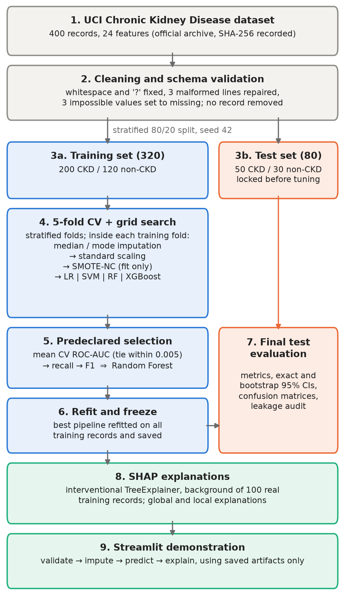
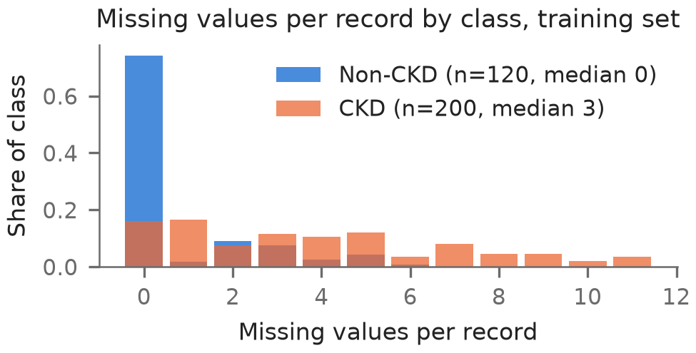
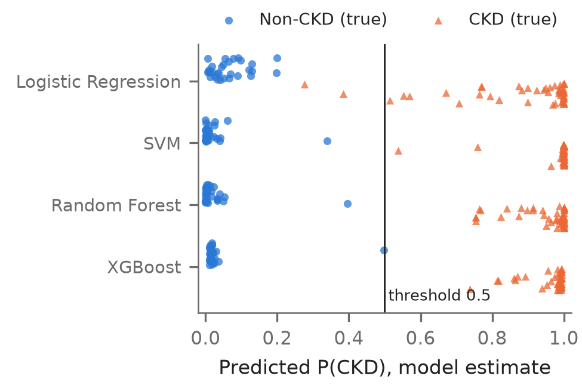
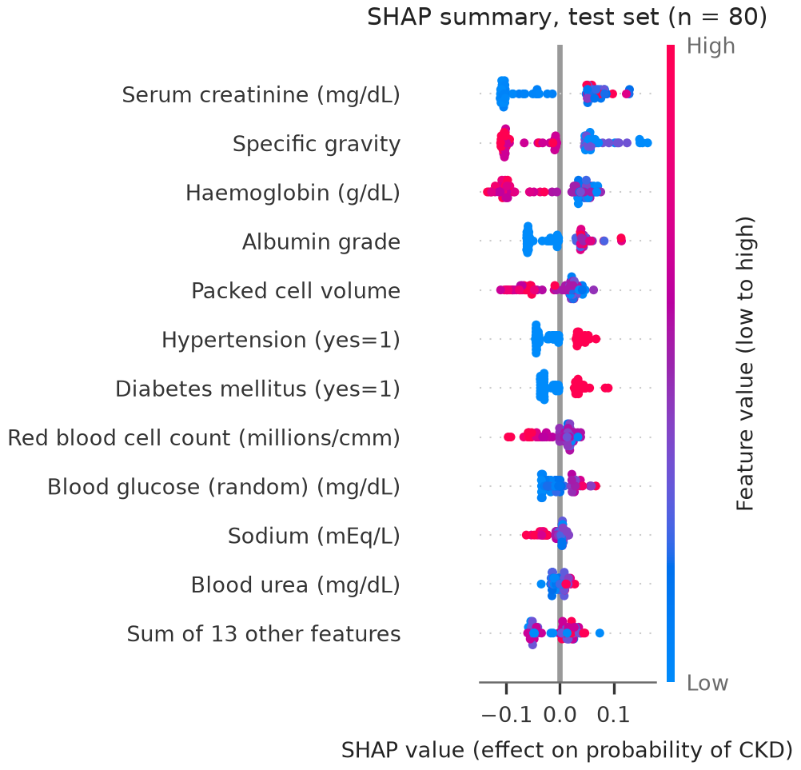
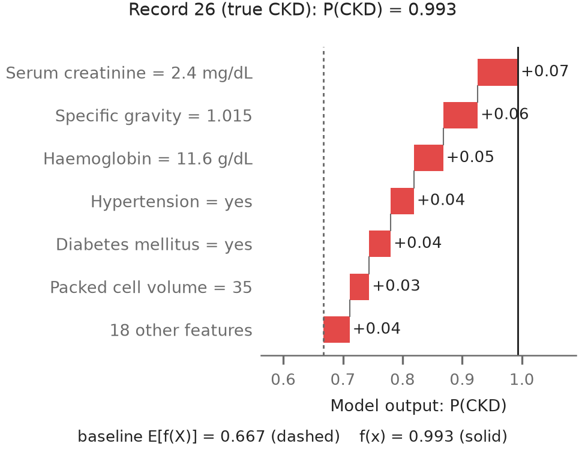
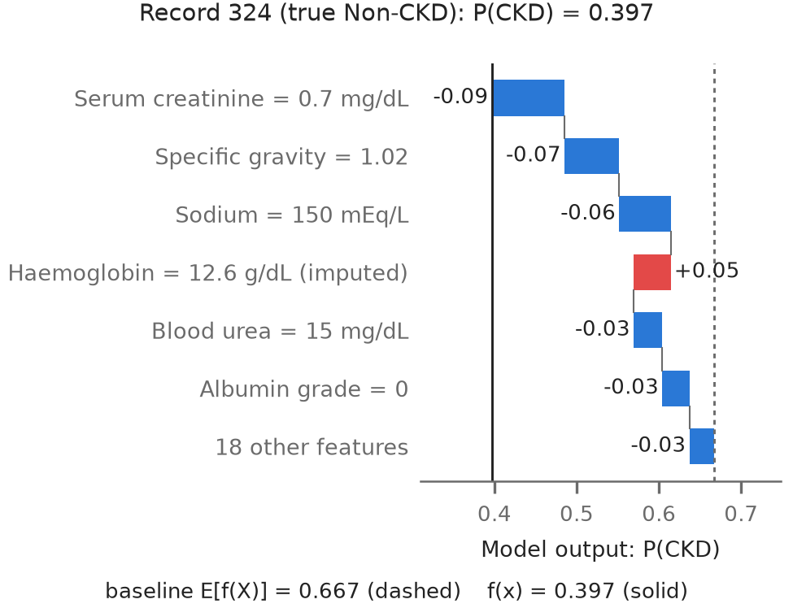

# Explainable Machine Learning for Chronic Kidney Disease Prediction Using SHAP-Based Feature Attribution

**Vedank Singh**  
*School of Computer Engineering, Manipal Institute of Technology*  
*Manipal Academy of Higher Education, Manipal, India*  

**Abstract** - Chronic kidney disease often progresses silently, and machine learning models that flag it from routine tests are only useful to clinicians if their predictions can be explained. This paper presents a reproducible pipeline that compares logistic regression, a support vector machine, a random forest and extreme gradient boosting on the 400-record University of California, Irvine chronic kidney disease dataset, and explains the selected model with Shapley additive explanations. Missing values were imputed, classes were balanced with a synthetic oversampling method for mixed numeric and categorical data, and every learned step was fitted inside the training folds only. A rule fixed in advance chose the model by its mean five-fold cross-validated area under the receiver operating characteristic curve, with recall and F1-score as tie-breakers. All four models scored between 0.9988 and 1.0000; the random forest was selected and classified all 80 untouched test records correctly (exact 95% confidence interval for accuracy 0.955–1.000). Serum creatinine, specific gravity, haemoglobin, albumin and packed cell volume drove its predictions, in line with clinical markers of kidney damage and anaemia. Oversampling gave no consistent benefit, and the near-perfect separability, informative missingness and single-centre data mean that these results do not establish clinical validity.

**Index Terms** - Chronic kidney disease, class imbalance, explainable artificial intelligence, machine learning, Shapley additive explanations

## I. Introduction

### A. Problem and Motivation

Chronic kidney disease (CKD) is defined by abnormalities of kidney structure or function, such as a reduced glomerular filtration rate (GFR) or albuminuria, that persist for more than three months [1], [2]. The Global Burden of Disease Study estimated that 788 million adults had CKD in 2023, an age-standardised prevalence of 14.2% [3]. Because early CKD rarely causes symptoms, many patients are identified late, when fewer options remain to slow its progression [4]. Routine blood and urine tests carry much of the information needed to flag likely CKD, which has made CKD prediction a popular machine learning (ML) task [5]–[7].

High accuracy alone is not enough in a clinical setting: a clinician must see why a model reached a decision before judging whether to trust it, and model opacity remains a main barrier to ML in healthcare [8]. Post-hoc methods such as local interpretable model-agnostic explanations (LIME) [9] and Shapley additive explanations (SHAP) [10] attribute each prediction to the input features and so open the model's behaviour to inspection.

### B. Objectives

1) To acquire, validate and preprocess the UCI CKD dataset, handling missing values, categorical encoding, feature scaling and class imbalance without leaking information from evaluation data.
2) To tune and compare logistic regression (LR), a support vector machine (SVM), a random forest (RF) and XGBoost using accuracy, precision, recall, F1-score and the area under the receiver operating characteristic curve (ROC-AUC), and to select one model.
3) To explain the selected model globally and for individual patients with SHAP, and to compare the most influential features with the clinical literature.

### C. Contribution

The contribution is a reproducible comparative prediction and explanation pipeline, not a new algorithm. Three refinements were made to the project synopsis: the final model is chosen by cross-validation on the training set instead of by test-set performance, so the untouched test set gives an unbiased final estimate; SMOTE is replaced by its mixed-data variant SMOTE-NC [11], so synthetic records never contain impossible category values; and every reported number is produced by scripts with a fixed seed, an automated leakage audit and a SHAP additivity check. A local Streamlit application demonstrates the saved model. Figure 1 summarises the workflow.

*Figure 1. System workflow. Blue steps use training records only; the test partition (orange) is locked after the split and used once, for the final evaluation of the frozen pipelines.*

## II. Related Work

The UCI CKD dataset [12] is the most widely used benchmark for CKD classification. Charleonnan et al. [5] compared k-nearest neighbours, SVM, LR and decision trees. Yang et al. [6] compared eight classical and three neural-network classifiers on the UCI data with SMOTE-NC balancing and feature selection, and found almost no difference between the balanced and unbalanced versions. Phuong et al. [7] reported 100% accuracy for RF, XGBoost, SVM and LR after adding polynomial features. Khalid et al. [13] proposed a stacked hybrid ensemble, and Khan et al. [14] compared five classifier families on a Pakistani cohort.

Several studies add explanations. Singamsetty et al. [15] tuned models by grid search and applied LIME and SHAP (99.07% accuracy). Dharmarathne et al. [16] explained XGBoost with SHAP and partial dependence plots behind a graphical interface. Ghosh and Khandoker [17] found creatinine, glycated haemoglobin and age most influential in a 491-patient hospital cohort. Chouit et al. [18] combined XGBoost, SMOTE, SHAP and LIME; on the UCI data, specific gravity, haemoglobin and serum creatinine led. Rezk et al. [19] added generative adversarial imputation and few-shot learning. This project keeps to conventional classifiers but combines what these studies rarely report together: a predeclared training-only selection rule, mixed-type oversampling inside cross-validation with an ablation, exact uncertainty intervals and a verified SHAP decomposition.

## III. Dataset and Preprocessing

### A. Data Source

The data are the UCI Chronic Kidney Disease dataset [12], donated in 2015 and, according to its documentation, collected over about two months at a hospital in Tamil Nadu, India. It has 400 records (250 CKD, 150 non-CKD) and 24 predictors (Table 1). CKD is the positive class. Units were copied from the documentation; where none is given, none is assumed.

**Table 1.** Predictors in the UCI CKD dataset (units as documented)

| Type | Features |
|---|---|
| Numeric (11) | age (years); blood pressure (mm Hg); random blood glucose, blood urea, serum creatinine (mg/dL); sodium, potassium (mEq/L); haemoglobin (g/dL); packed cell volume (no unit documented); white cell count (cells/cumm); red cell count (millions/cmm) |
| Ordinal (3) | specific gravity (1.005–1.025, five levels); albumin and sugar grades (0–5) |
| Binary (10) | red blood cells, pus cells (normal/abnormal); pus cell clumps, bacteria (present/absent); hypertension, diabetes mellitus, coronary artery disease, pedal oedema, anaemia (yes/no); appetite (good/poor) |
| Target | CKD = 1 (positive, n = 250); non-CKD = 0 (n = 150) |

### B. Acquisition, Cleaning and Validation

A script downloads the official archive, caches it and records SHA-256 checksums; a local-file option supports offline use. The original attribute-relation (ARFF) file contained stray tabs and spaces in 16 cells (including two class labels), "?" for missing values, two lines with a trailing comma and one with a doubled comma. Each defect was repaired by an explicit, logged rule, and the result matched UCI's own CSV conversion cell for cell. Three physiologically impossible values (sodium 4.5 mEq/L; potassium 39 and 47 mEq/L) fell outside plausibility limits fixed before modelling and were set to missing; no record was removed. No two records share a predictor vector. Overall, 1015 of 9600 values (10.6%) are missing, and 243 records have at least one gap.

### C. Exploratory Analysis

Class-conditioned exploration used only the 320 training records. CKD records had higher serum creatinine (median 2.3 vs 0.9 mg/dL) and albumin grades, and lower haemoglobin (10.9 vs 15.2 g/dL), packed cell volume (33 vs 45) and specific gravity (1.015 vs 1.020). Strikingly, none of the ten binary abnormalities, including hypertension and diabetes, occurs in any non-CKD training record, which suggests that the non-CKD group consists of screened healthy controls. Missingness also differs by class (Figure 2): the red cell count, for example, is missing in 50.5% of CKD but 3.3% of non-CKD training records. The strongest correlation links haemoglobin and packed cell volume (Spearman ρ = 0.87). These are associations within this sample, not causal effects.

*Figure 2. Missing values per record in the training set, by class. Non-CKD records are mostly complete, so the pattern of missingness itself carries class information.*

### D. Preprocessing

All preprocessing is fitted on training data inside one pipeline per model. Numeric features are imputed with the training median and standardised; ordinal grades are imputed with the training mode and standardised; binary features are encoded as 0/1 (1 = abnormal, present, yes or poor), and a category unseen at prediction time is treated as missing. Each predictor maps to exactly one model column, so SHAP values need no aggregation over one-hot columns. Scaling is needed by LR, SVM and the distance computation in SMOTE-NC; it does not change the splits of the tree models.

### E. Class Imbalance with SMOTE-NC

The training set has a 200:120 class ratio, so the minority class is non-CKD. SMOTE [11] creates a synthetic minority record by interpolating between a minority record xi and one of its k nearest minority neighbours x̂i:

$$ x' = x_i + \lambda\,(\hat{x}_i - x_i), \quad \lambda \sim U(0,1) \tag{1} $$

Interpolating 0/1 columns would create fractional "patients" with, say, 0.4 hypertension. SMOTE-NC, defined in the same paper, interpolates only continuous features, gives each nominal feature the most frequent value among the k neighbours and penalises nominal mismatches in the distance. The ordinal grades were also treated as nominal during resampling, so every synthetic record has valid levels (verified by the test suite). SMOTE-NC (k = 5) is a step of the imbalanced-learn pipeline [20], so it runs only when a pipeline is fitted on training data and never touches validation or test records.

## IV. Proposed Methodology

### A. Data Split and Classifiers

Following Figure 1, a stratified test partition of 80 records (50 CKD, 30 non-CKD; 20%, seed 42) was created and locked, with a checksum of its record identifiers, before any tuning. Four classifiers spanning linear, kernel, bagging and boosting approaches were implemented with scikit-learn [21] and XGBoost: LR [22] with an L1 or L2 penalty; an SVM [23] with a radial-basis (RBF) or linear kernel, whose decision scores are turned into probabilities by sigmoid calibration fitted through an internal five-fold split of the training data; RF [24]; and XGBoost [25] with the binary logistic objective and the CPU histogram tree method. These are also the models most often compared on CKD data [6], [7].

### B. Tuning and Predeclared Selection

Hyperparameters were tuned by exhaustive grid search with stratified five-fold cross-validation (CV) on the training set (56 candidates, 280 fits): LR with C ∈ {0.01, …, 100} and an L1 or L2 penalty; SVM with an RBF kernel (C ∈ {0.1, …, 100}, γ ∈ {scale, 0.01, 0.1}) or a linear kernel; RF with 300 trees, depth ∈ {unlimited, 4, 8}, minimum leaf ∈ {1, 3, 5} and √p or 0.5 features per split; and XGBoost with 100 or 300 trees, depth ∈ {2, 3, 4}, learning rate ∈ {0.05, 0.1} and 0.8 row and column subsampling. All metrics use the predicted CKD probability at the default threshold of 0.5, which was not tuned.

The selection rule was written into the configuration file before any score was computed: the highest mean CV ROC-AUC wins; models within 0.005 of the best are tied and ranked by mean CV recall, then F1-score, then simplicity. A validation fold holds about 40 CKD and 24 non-CKD records, so one mis-ordered pair moves its ROC-AUC by about 0.001. The synopsis proposed choosing the model with the best held-out test score; that would bias the test estimate upwards, because the same records would select and grade the model [26]. Here the test set is used once, after selection, to evaluate all four frozen models.

### C. Leakage Prevention

Leakage [27] was prevented by design and then audited. Imputation, scaling, resampling and fitting all happen inside the pipeline; the record identifier and target are excluded from the predictors; the test set is locked; and the selection is saved before the evaluation code reads any test record. An automated audit checks 11 properties, including that the fitted imputation medians equal the training-only medians, that predictions bypass the resampler, that no predictor vector appears in both partitions, and that training on shuffled labels gives chance-level CV ROC-AUC (mean 0.505).

### D. Evaluation Metrics and Uncertainty

With CKD as the positive class and TP, FP and FN the true positives, false positives and false negatives, precision P and recall R are

$$ P = \frac{TP}{TP+FP}, \qquad R = \frac{TP}{TP+FN} \tag{2} $$

and the F1-score is 2PR/(P + R). A false negative is a missed CKD case, the more harmful error in screening; a false positive sends a person without CKD for unnecessary follow-up. ROC-AUC measures ranking quality independently of the threshold. Because the test set is small, 95% Clopper-Pearson exact intervals are reported for proportions, and stratified bootstrap intervals (2000 resamples) were also computed.

## V. Experimental Setup and Results

### A. Setup and Reproducibility

Experiments ran on a laptop with an AMD Ryzen 7 7840HS processor and 16 GB of memory under Windows 11, using Python 3.13, scikit-learn 1.9.1, imbalanced-learn 0.14.2, XGBoost 3.4.1 and SHAP 0.53.0. All settings live in one configuration file with seed 42. The whole pipeline took 33 s (grid searches 12 s), and a full re-run reproduced the CV results and test predictions byte for byte. One prediction took a median of 46 ms and its explanation 82 ms. Forty-five automated tests cover cleaning, schema validation, leakage, saved-model consistency, inference, SHAP consistency and the application.

### B. Cross-Validation Comparison and Selection

The selected configurations were: Logistic Regression, L2 penalty, C = 0.1; SVM, RBF kernel, C = 1, γ = scale; Random Forest, 300 trees, depth unlimited, max features sqrt, min leaf 1; XGBoost, 100 trees, depth 2, learning rate 0.05, subsample 0.8. Table 2 gives their CV scores. Mean CV ROC-AUC ranged from 0.9988 to 1.0000, so all four models were tied under the predeclared tolerance. Random Forest had the highest mean CV recall (1.000) and F1-score (0.995) and was selected; SVM had the highest ROC-AUC (1.0000) but a recall of 0.985. Pooled out-of-fold ROC-AUCs were between 0.9990 and 0.9998.

**Table 2.** Five-fold CV results of the tuned models on the training set (mean ± SD; * = selected)

| Metric | LR | SVM | RF* | XGBoost |
|---|---|---|---|---|
| ROC-AUC | 0.999
± 0.001 | 1.000
± 0.000 | 0.999
± 0.001 | 0.999
± 0.002 |
| Accuracy | 0.975
± 0.025 | 0.991
± 0.019 | 0.994
± 0.008 | 0.981
± 0.015 |
| Precision | 1.000
± 0.000 | 1.000
± 0.000 | 0.990
± 0.012 | 0.985
± 0.020 |
| Recall | 0.960
± 0.041 | 0.985
± 0.030 | 1.000
± 0.000 | 0.985
± 0.012 |
| F1-score | 0.979
± 0.021 | 0.992
± 0.016 | 0.995
± 0.006 | 0.985
± 0.012 |

### C. Effect of SMOTE-NC

Table 3 compares each tuned model with and without SMOTE-NC on the same folds. The differences are tiny and inconsistent: resampling slightly lowered recall and F1-score for LR, SVM and XGBoost and slightly raised them for RF, and every change is smaller than one fold standard deviation. The imbalance is mild (62.5:37.5), and Yang et al. reported a similar null result on this dataset [6]. Resampling also shifts predicted probabilities away from the true prevalence [28], so the probabilities below are read as rankings rather than risks. SMOTE-NC was kept, as the synopsis specifies, but no benefit is claimed.

**Table 3.** Change in mean CV score when SMOTE-NC is used (SMOTE-NC minus no resampling)

| Model | ROC-AUC | Recall | F1-score | Specificity |
|---|---|---|---|---|
| Logistic Regression | 0.000 | −0.005 | −0.003 | 0.000 |
| SVM | 0.000 | −0.010 | −0.005 | 0.000 |
| Random Forest | +0.001 | 0.000 | +0.002 | +0.008 |
| XGBoost | 0.000 | −0.005 | −0.003 | 0.000 |

A further probe asks how much class information lies in missingness alone: an LR model trained only on the 24 missing-value indicators reached a mean CV ROC-AUC of 0.864 (SD 0.047). Which values are missing, probably reflecting which tests were ordered, is itself highly predictive, and a model may partly exploit it [29].

### D. Final Test Results

Table 4 reports the frozen models on the 80 test records. SVM, Random Forest and XGBoost classified every record correctly (ROC-AUC 1.000); LR missed two CKD cases (records 102 and 224) that had serum creatinine of 2.1 and 2.2 mg/dL but no hypertension, diabetes or anaemia. For the selected Random Forest, the exact 95% interval is 0.955–1.000 for accuracy and 0.929–1.000 for recall, so the data remain compatible with a few errors per hundred patients; the bootstrap intervals collapse to a single value when no error occurs and are therefore not shown.

**Table 4.** Frozen models on the held-out test set (n = 80; exact 95% CI below each proportion; * = selected)

| Metric | LR | SVM | RF* | XGBoost |
|---|---|---|---|---|
| ROC-AUC | 1.000 | 1.000 | 1.000 | 1.000 |
| Accuracy | 0.975
0.913–0.997 | 1.000
0.955–1.000 | 1.000
0.955–1.000 | 1.000
0.955–1.000 |
| Precision | 1.000 | 1.000 | 1.000 | 1.000 |
| Recall | 0.960
0.863–0.995 | 1.000
0.929–1.000 | 1.000
0.929–1.000 | 1.000
0.929–1.000 |
| Specificity | 1.000
0.884–1.000 | 1.000
0.884–1.000 | 1.000
0.884–1.000 | 1.000
0.884–1.000 |
| F1-score | 0.980 | 1.000 | 1.000 | 1.000 |
| FP / FN | 0 / 2 | 0 / 0 | 0 / 0 | 0 / 0 |

Figure 3 shows that perfect accuracy hides a near miss: non-CKD record 324 scored 0.397 under RF and 0.497 under XGBoost, just below the threshold.

### E. Investigating the Perfect Scores

Perfect test scores prompted a search for leakage. The audit passed all 11 checks, no record is duplicated across the split, and shuffled labels gave chance-level performance. The explanation lies in the data: the classes are almost separable by single features (serum creatinine interquartile ranges of 1.4-4.6 vs 0.7-1.1 mg/dL), and non-CKD records contain no abnormal binary finding. Other studies on this dataset report similar accuracy [7], [15]. Such separability means the results say little about early or borderline CKD and do not demonstrate clinical readiness.

*Figure 3. Predicted CKD probabilities on the test set by true class (circles: non-CKD, triangles: CKD). Records near the threshold are the least certain predictions.*

## VI. SHAP Explainability and Discussion

### A. Method

For a record x with M = 24 features, SHAP [10] gives feature j the Shapley value

$$ \phi_j = \sum_{S \subseteq F \setminus \{j\}} w_S\,\big[v(S \cup \{j\}) - v(S)\big] \tag{3} $$

where F is the set of all features, the weight wS = |S|!(M − |S| − 1)!/M! averages over all orders in which features can be added, and v(S) is the expected model output when the features in S keep the record's values and the others are taken from a background set B of training records:

$$ v(S) = \frac{1}{|B|} \sum_{\mathbf{z} \in B} f(\mathbf{x}_S, \mathbf{z}_{\bar S}) \tag{4} $$

The values satisfy local accuracy,

$$ f(\mathbf{x}) = \phi_0 + \sum_{j=1}^{M} \phi_j \tag{5} $$

where the baseline φ0 is the average model output over B. The explained output is the Random Forest's probability of CKD, so a positive φj pushes a prediction towards CKD. Interventional Tree SHAP [30] was used with a background of 100 real training records (no synthetic records), giving φ0 = 0.667. Attributions are reported per original feature, with values converted back to clinical units after imputation.

Identity (5) was checked for every explained record. It first failed by up to 0.0065, because the SHAP library routed background values lying within single-precision rounding of a split threshold differently from scikit-learn; SMOTE-NC makes such near-ties likely by creating values almost identical to real ones. The explainer therefore uses a copy of the forest with its thresholds (1755 of 3679) rounded down to single precision, which provably leaves every prediction unchanged; the maximum error then fell to 1.8 × 10-8.

### B. Global Importance

Figure 4 and Table 5 summarise the SHAP values on the 80 test records. Serum creatinine, specific gravity, haemoglobin, albumin grade and packed cell volume are the five most influential features, with 63.7% of the total attribution; the ranking on the 320 training records is nearly identical (Spearman ρ = 0.995). The effects are threshold-like: creatinine contributions are negative for every test record at or below 1.2 mg/dL and positive from 1.3 mg/dL, and haemoglobin contributions are positive up to 12.7 g/dL and negative from 12.8 g/dL. Specific gravity of 1.005–1.015 and any albumin grade above 0 push towards CKD.

**Table 5.** Top six SHAP features (test set)

| # | Feature | Mean |SHAP| | % | CKD when |
|---|---|---|---|---|
| 1 | Serum creatinine | 0.079 | 16.4 | high |
| 2 | Specific gravity | 0.075 | 15.4 | low (≤ 1.015) |
| 3 | Haemoglobin | 0.067 | 13.8 | low |
| 4 | Albumin grade | 0.045 | 9.3 | grade ≥ 1 |
| 5 | Packed cell volume | 0.043 | 8.8 | low |
| 6 | Hypertension | 0.033 | 6.9 | yes |

*Figure 4. SHAP summary plot of the selected Random Forest on the test set. Each dot is one record; its position is the contribution to the probability of CKD and its colour the feature value (red = high; for binary features, red = the condition in brackets).*

### C. Local Explanations

Examples were chosen by a fixed rule: for each class, the correctly classified test record whose probability is closest to that class's median, plus the record closest to the threshold. CKD record 26 (Figure 5) reaches P(CKD) = 0.993 mainly through serum creatinine of 2.4 mg/dL (+0.067), specific gravity of 1.015 (+0.058) and haemoglobin of 11.6 g/dL (+0.049). The typical non-CKD record 270 is pushed down to 0.003 by haemoglobin of 14.3 g/dL (-0.113), serum creatinine of 1.1 mg/dL (-0.107) and specific gravity of 1.025 (-0.106). For the least certain record, 324 (Figure 6; true non-CKD, P = 0.397), low creatinine and a specific gravity of 1.020 push the output down, but its missing haemoglobin, imputed with the training median of 12.6 g/dL, pushes it towards CKD. That median is low because CKD records dominate the training set, which shows how median imputation interacts with informative missingness. The selected Random Forest made no test error, so there is no misclassified record to explain.

### D. Comparison with Clinical Literature

The leading features agree with clinical knowledge. Serum creatinine is the basis of estimated GFR [31], and reduced GFR is one of the two criteria that define CKD [2]. Albumin in urine is the marker of kidney damage behind the albuminuria categories [1], [2]. Low haemoglobin, packed cell volume and red cell count reflect anaemia, which becomes more common as CKD advances [32]. Hypertension and diabetes are leading risk factors for CKD [3], [4]. Specific gravity is not part of the definition of CKD [2]; its high rank matches the earlier SHAP analysis of this dataset by Chouit et al. [18] and may reflect a reduced ability to concentrate urine, although these data cannot test that explanation.

*Figure 5. SHAP waterfall plot for typical CKD test record 26. Red bars push the output towards CKD, blue bars towards non-CKD; the bars add up exactly from the baseline to f(x).*

*Figure 6. SHAP waterfall plot for non-CKD test record 324, the prediction closest to the threshold. Haemoglobin was missing and imputed.*

### E. Limits of the Interpretation

SHAP explains how this model uses its inputs, not how kidney disease arises, and post-hoc explanations should not be over-trusted [33]. Correlated features (haemoglobin, packed cell volume, red cell count) share credit in model-dependent ways, the interventional background treats features as independent, and imputed values are attributed as if measured. Agreement with the literature suggests the model relies on plausible signals; it does not validate it clinically.

## VII. Demonstration System

A five-page Streamlit application loads the saved pipeline and SHAP background and never retrains. Its form lists the 24 inputs with units and allowed categories, rejects impossible values, imputes blank fields exactly as the pipeline does and reports them, and warns about values outside the training range. It shows the CKD probability, the predicted class and a waterfall explanation whose baseline plus contributions is checked against the displayed probability. Every page states that the tool is an educational prototype, not a diagnostic device; no treatment advice is given.

## VIII. Limitations and Conclusion

### A. Limitations

- Data: 400 single-centre records with an apparently healthy non-CKD group, an easier task than real screening.
- Sample size: 80 test records; perfect accuracy is compatible with a true accuracy of 95.5%.
- Labels: no estimated GFR or repeat measurements, so the three-month chronicity criterion cannot be checked [2].
- Missingness alone predicts the class (CV ROC-AUC 0.864); part of the signal may reflect testing practice.
- Probabilities are uncalibrated and should be read as rankings.
- No external validation was performed, which TRIPOD+AI expects before clinical claims [34].

### B. Conclusion and Future Work

A reproducible pipeline compared LR, SVM, RF and XGBoost for CKD prediction on the UCI dataset with leakage-free preprocessing, SMOTE-NC inside the training folds and a selection rule fixed in advance. All four models were nearly perfect in cross-validation; the selected Random Forest classified all 80 test records correctly, and SHAP showed that it relies mainly on serum creatinine, specific gravity, haemoglobin, albumin and packed cell volume, in agreement with clinical knowledge and earlier work. The same checks exposed the limits of the dataset: oversampling did not help, missingness is informative, and the classes are unrealistically separable. Future work should validate the pipeline on larger, independent cohorts with GFR-based labels, assess calibration, model missingness explicitly, and compare the stability of explanations across models.

## Acknowledgment

The author thanks Dr. Narendra V G, Professor, and Ms Vibha, Assistant Professor - Senior Scale, School of Computer Engineering, Manipal Institute of Technology, for their guidance.

## References

[1] A. S. Levey et al., "Definition and classification of chronic kidney disease: A position statement from Kidney Disease: Improving Global Outcomes (KDIGO)," *Kidney Int.*, vol. 67, no. 6, pp. 2089–2100, Jun. 2005, doi: 10.1111/j.1523-1755.2005.00365.x.

[2] Kidney Disease: Improving Global Outcomes (KDIGO) CKD Work Group, "KDIGO 2024 clinical practice guideline for the evaluation and management of chronic kidney disease," *Kidney Int.*, vol. 105, no. 4S, pp. S117–S314, Apr. 2024, doi: 10.1016/j.kint.2023.10.018.

[3] GBD 2023 Chronic Kidney Disease Collaborators, "Global, regional, and national burden of chronic kidney disease in adults, 1990–2023, and its attributable risk factors: A systematic analysis for the Global Burden of Disease Study 2023," *Lancet*, vol. 406, no. 10518, pp. 2461–2482, Nov. 2025, doi: 10.1016/S0140-6736(25)01853-7.

[4] A. C. Webster, E. V. Nagler, R. L. Morton, and P. Masson, "Chronic kidney disease," *Lancet*, vol. 389, no. 10075, pp. 1238–1252, Mar. 2017, doi: 10.1016/S0140-6736(16)32064-5.

[5] A. Charleonnan, T. Fufaung, T. Niyomwong, W. Chokchueypattanakit, S. Suwannawach, and N. Ninchawee, "Predictive analytics for chronic kidney disease using machine learning techniques," in *Proc. Manage. Innov. Technol. Int. Conf. (MITicon)*, Bang-Saen, Thailand, 2016, pp. MIT-80–MIT-83, doi: 10.1109/MITICON.2016.8025242.

[6] W. Yang, N. Ahmed, and A. L. C. Barczak, "Comparative analysis of machine learning algorithms for CKD risk prediction," *IEEE Access*, vol. 12, pp. 171205–171220, 2024, doi: 10.1109/ACCESS.2024.3499355.

[7] N. D. Phuong, N. T. Tuyen, V. T. T. Linh, N. N. Nguyen, and T. Q. Nguyen, "Machine learning techniques in chronic kidney diseases: A comparative study of classification model performance," *Bioinform. Biol. Insights*, vol. 19, Art. no. 11779322251356563, 2025, doi: 10.1177/11779322251356563.

[8] H. W. Loh, C. P. Ooi, S. Seoni, P. D. Barua, F. Molinari, and U. R. Acharya, "Application of explainable artificial intelligence for healthcare: A systematic review of the last decade (2011–2022)," *Comput. Methods Programs Biomed.*, vol. 226, Art. no. 107161, Nov. 2022, doi: 10.1016/j.cmpb.2022.107161.

[9] M. T. Ribeiro, S. Singh, and C. Guestrin, "'Why should I trust you?': Explaining the predictions of any classifier," in *Proc. 22nd ACM SIGKDD Int. Conf. Knowl. Discovery Data Mining*, San Francisco, CA, USA, 2016, pp. 1135–1144, doi: 10.1145/2939672.2939778.

[10] S. M. Lundberg and S.-I. Lee, "A unified approach to interpreting model predictions," in *Advances in Neural Information Processing Systems*, vol. 30, Long Beach, CA, USA, 2017.

[11] N. V. Chawla, K. W. Bowyer, L. O. Hall, and W. P. Kegelmeyer, "SMOTE: Synthetic minority over-sampling technique," *J. Artif. Intell. Res.*, vol. 16, pp. 321–357, Jun. 2002, doi: 10.1613/jair.953.

[12] L. Rubini, P. Soundarapandian, and P. Eswaran, "Chronic kidney disease," UCI Machine Learning Repository, 2015. [Dataset]. doi: 10.24432/C5G020.

[13] H. Khalid, A. Khan, M. Z. Khan, G. Mehmood, and M. S. Qureshi, "Machine learning hybrid model for the prediction of chronic kidney disease," *Comput. Intell. Neurosci.*, vol. 2023, Art. no. 9266889, 2023, doi: 10.1155/2023/9266889.

[14] N. Khan et al., "Unveiling the predictive power: A comprehensive study of machine learning model for anticipating chronic kidney disease," *Front. Artif. Intell.*, vol. 6, Art. no. 1339988, Jan. 2024, doi: 10.3389/frai.2023.1339988.

[15] S. Singamsetty, S. Ghanta, S. Biswas, and A. Pradhan, "Enhancing machine learning-based forecasting of chronic renal disease with explainable AI," *PeerJ Comput. Sci.*, vol. 10, Art. no. e2291, Sep. 2024, doi: 10.7717/peerj-cs.2291.

[16] G. Dharmarathne, M. Bogahawaththa, M. McAfee, U. Rathnayake, and D. P. P. Meddage, "On the diagnosis of chronic kidney disease using a machine learning-based interface with explainable artificial intelligence," *Intell. Syst. Appl.*, vol. 22, Art. no. 200397, Jun. 2024, doi: 10.1016/j.iswa.2024.200397.

[17] S. K. Ghosh and A. H. Khandoker, "Investigation on explainable machine learning models to predict chronic kidney diseases," *Sci. Rep.*, vol. 14, no. 1, Art. no. 3687, Feb. 2024, doi: 10.1038/s41598-024-54375-4.

[18] E. M. Chouit, M. Rachdi, M. Bellafkih, and B. Raouyane, "Interpretable machine learning for chronic kidney disease prediction: Insights from SHAP and LIME analyses," *PLOS One*, vol. 21, no. 2, Art. no. e0343205, Feb. 2026, doi: 10.1371/journal.pone.0343205.

[19] N. G. Rezk, S. Alshathri, A. Sayed, and E. E.-D. Hemdan, "Explainable AI for chronic kidney disease prediction in medical IoT: Integrating GANs and few-shot learning," *Bioengineering*, vol. 12, no. 4, Art. no. 356, Mar. 2025, doi: 10.3390/bioengineering12040356.

[20] G. Lemaître, F. Nogueira, and C. K. Aridas, "Imbalanced-learn: A Python toolbox to tackle the curse of imbalanced datasets in machine learning," *J. Mach. Learn. Res.*, vol. 18, no. 17, pp. 1–5, 2017.

[21] F. Pedregosa et al., "Scikit-learn: Machine learning in Python," *J. Mach. Learn. Res.*, vol. 12, pp. 2825–2830, 2011.

[22] D. R. Cox, "The regression analysis of binary sequences," *J. Roy. Statist. Soc. Ser. B*, vol. 20, no. 2, pp. 215–232, Jul. 1958, doi: 10.1111/j.2517-6161.1958.tb00292.x.

[23] C. Cortes and V. Vapnik, "Support-vector networks," *Mach. Learn.*, vol. 20, no. 3, pp. 273–297, Sep. 1995, doi: 10.1007/BF00994018.

[24] L. Breiman, "Random forests," *Mach. Learn.*, vol. 45, no. 1, pp. 5–32, Oct. 2001, doi: 10.1023/A:1010933404324.

[25] T. Chen and C. Guestrin, "XGBoost: A scalable tree boosting system," in *Proc. 22nd ACM SIGKDD Int. Conf. Knowl. Discovery Data Mining*, San Francisco, CA, USA, 2016, pp. 785–794, doi: 10.1145/2939672.2939785.

[26] S. Varma and R. Simon, "Bias in error estimation when using cross-validation for model selection," *BMC Bioinf.*, vol. 7, Art. no. 91, 2006, doi: 10.1186/1471-2105-7-91.

[27] S. Kaufman, S. Rosset, C. Perlich, and O. Stitelman, "Leakage in data mining: Formulation, detection, and avoidance," *ACM Trans. Knowl. Discovery Data*, vol. 6, no. 4, pp. 1–21, Dec. 2012, doi: 10.1145/2382577.2382579.

[28] R. van den Goorbergh, M. van Smeden, D. Timmerman, and B. Van Calster, "The harm of class imbalance corrections for risk prediction models: Illustration and simulation using logistic regression," *J. Amer. Med. Inform. Assoc.*, vol. 29, no. 9, pp. 1525–1534, Sep. 2022, doi: 10.1093/jamia/ocac093.

[29] R. H. H. Groenwold, "Informative missingness in electronic health record systems: The curse of knowing," *Diagn. Progn. Res.*, vol. 4, Art. no. 8, 2020, doi: 10.1186/s41512-020-00077-0.

[30] S. M. Lundberg et al., "From local explanations to global understanding with explainable AI for trees," *Nature Mach. Intell.*, vol. 2, no. 1, pp. 56–67, Jan. 2020, doi: 10.1038/s42256-019-0138-9.

[31] A. S. Levey et al., "A new equation to estimate glomerular filtration rate," *Ann. Intern. Med.*, vol. 150, no. 9, pp. 604–612, May 2009, doi: 10.7326/0003-4819-150-9-200905050-00006.

[32] M. E. Stauffer and T. Fan, "Prevalence of anemia in chronic kidney disease in the United States," *PLoS One*, vol. 9, no. 1, Art. no. e84943, Jan. 2014, doi: 10.1371/journal.pone.0084943.

[33] C. Rudin, "Stop explaining black box machine learning models for high stakes decisions and use interpretable models instead," *Nature Mach. Intell.*, vol. 1, no. 5, pp. 206–215, May 2019, doi: 10.1038/s42256-019-0048-x.

[34] G. S. Collins et al., "TRIPOD+AI statement: Updated guidance for reporting clinical prediction models that use regression or machine learning methods," *BMJ*, vol. 385, Art. no. e078378, Apr. 2024, doi: 10.1136/bmj-2023-078378.

## About the Author

Vedank Singh is a fifth-semester B.Tech. (CSE, AI and ML) student at Manipal Institute of Technology, India.
